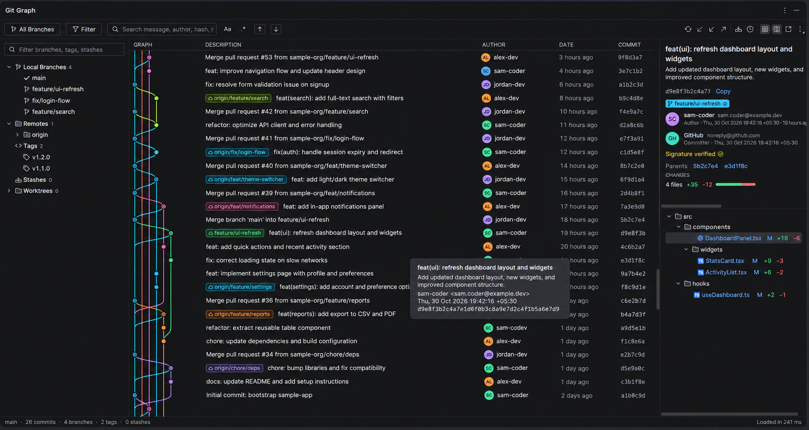

<div align="center">

# VT Git Graph

**A complete visual Git client inside IntelliJ IDEA.**

See every branch as a colored commit graph, inspect any commit, and run everyday and advanced Git operations directly from the graph.




</div>

## Contents

- [Why VT Git Graph](#why-vt-git-graph)
- [Features](#features)
- [Compatibility](#compatibility)
- [Installation](#installation)
- [Getting started](#getting-started)
- [Git operations](#git-operations)
- [Safety](#safety)
- [Keyboard and mouse shortcuts](#keyboard-and-mouse-shortcuts)
- [Display options](#display-options)
- [Building from source](#building-from-source)
- [Testing](#testing)
- [Project structure](#project-structure)
- [Publishing](#publishing)
- [Troubleshooting](#troubleshooting)
- [License](#license)

## Why VT Git Graph

- **One view for your whole repository.** Branches, remotes, tags, stashes, worktrees, submodules and uncommitted changes sit next to the history they belong to.
- **Act where you are looking.** Right-click a commit, branch or tag to run the operation you need, without switching to a terminal.
- **Careful with your history.** Operations that rewrite commits check what they will affect and warn you first. See [Safety](#safety).
- **Built on your existing Git setup.** It runs through the IDE's Git integration, so it uses your configured Git executable and the IDE's authentication for remotes.

## Features

### Commit graph

- Colored lanes for branches and merges, with distinct nodes for merge commits, `HEAD`, stashes and uncommitted changes
- Branch, remote and tag labels on commits, with ahead and behind counts
- Sortable by commit date, author date or topological order
- Further history loads automatically as you scroll
- Updates automatically when the repository changes
- Opens as a tool window or as a full editor tab

### Search and filtering

- Search messages, authors, emails, hashes and ref names, with match highlighting
- Case-sensitive and regular expression search modes
- Filter by branch, author, message, path or date range
- First-parent history view
- File history from any changed file

### Commit details

- Full message, author, committer, signature status, parents and children
- Changed files as a tree, with status and added and removed line counts
- Diffs in the IDE's diff viewer
- Compare any two selected commits, or a commit with the working tree
- Open a file as it was at a revision, or restore that version to the working tree

### Repository sidebar

- Local branches and remote branches, grouped by folder
- Remotes, tags, stashes, worktrees and submodules
- Filter box and a context menu for each item

### Multiple repositories

Projects with more than one Git root get a repository selector in the toolbar.

## Compatibility

| Requirement | Version |
| --- | --- |
| IntelliJ IDEA | 2026.2 or newer (build 262+) |
| Git | 2.27 or newer |
| Git plugin | Bundled Git plugin, enabled |
| JDK, for building only | 25, downloaded automatically by Gradle if missing |

The plugin is verified with the IntelliJ Plugin Verifier against IntelliJ IDEA Ultimate `IU-262.10968.63`. It does not set an upper version limit, so check newer major IDE releases with the verifier before relying on them.

The plugin depends only on the base platform, VCS support and Git, so other JetBrains IDEs on build 262 or newer should accept it. These IDEs have not been tested.

## Installation

The plugin is installed from a zip file:

1. [Build the plugin](#building-from-source), which creates `build/distributions/vt-git-graph-1.0.0.zip`.
2. In the IDE, open **Settings | Plugins**.
3. Click the gear icon and choose **Install Plugin from Disk**.
4. Select the zip file and restart the IDE if prompted.

## Getting started

1. Open a project that contains a Git repository.
2. Open the **VT Git Graph** tool window, docked at the bottom of the IDE by default.
3. Click a commit to see its details, or select two commits to compare them.
4. Right-click a commit, branch label or sidebar item to see the available operations.

To use the graph as a full editor tab, choose **Git | Open VT Git Graph in Editor Tab**, or click the **Open in Editor Tab** toolbar button.

## Git operations

| Area | Operations |
| --- | --- |
| **Branches** | Create, rename, delete, check out, set upstream, fetch into a branch |
| **Remotes** | Add, rename, remove, edit URLs, fetch, prune, delete remote branches |
| **Sync** | Fetch, pull with rebase or fast-forward options, push with force-with-lease and upstream options |
| **Integrate** | Merge, including squash and no-fast-forward; rebase; cherry-pick; revert |
| **Rewrite history** | Interactive rebase, edit commit message, drop commit, undo last commit, reset |
| **Tags** | Create annotated or signed tags, delete, push one or all |
| **Stash** | Create, apply, pop, drop, clear, create a branch from a stash |
| **Working tree** | Stage, unstage, discard, clean untracked files, apply a patch |
| **Conflicts** | Resolve in the IDE's merge tool, then continue, skip or abort from a status banner |
| **Bisect** | Start from the graph, mark good, bad or skip, and see each result in a notification |
| **Worktrees** | Add, open in a new window, lock, unlock, remove, prune |
| **Submodules** | Update and sync, individually or all together |
| **Export** | Save a commit as a patch or a zip archive |
| **Recovery and upkeep** | Browse the reflog, check out or reset to an entry, run garbage collection |

## Safety

- **Rewrites stay on your branch.** Dropping, rewording or interactively rebasing a commit that is not on the current branch is refused before anything changes.
- **Merge commits are protected.** You are warned before a rewrite would flatten merges, and an older merge commit's message cannot be edited because that would remove the merge.
- **Published commits are flagged.** You are warned when a rewrite affects commits already on a remote, because it will require a force push.
- **Commit bodies are kept.** Rewording a commit in an interactive rebase changes its subject and keeps the rest of its message.
- **Destructive actions need confirmation.** Hard reset, force push, discard, clean and similar actions ask first. The dialogs for deleting a branch or tag, discarding all changes, cleaning untracked files and removing a worktree default to **Cancel**.
- **Failures are reported.** Git errors appear in a notification, and conflicts link directly to the merge tool.

## Keyboard and mouse shortcuts

| Action | Shortcut |
| --- | --- |
| Focus search | <kbd>Ctrl</kbd>+<kbd>F</kbd>, or <kbd>Cmd</kbd>+<kbd>F</kbd> on macOS |
| Refresh the graph | <kbd>F5</kbd> |
| Next search match | <kbd>Enter</kbd> |
| Previous search match | <kbd>Shift</kbd>+<kbd>Enter</kbd> |
| Clear search | <kbd>Esc</kbd> |
| Show the diff for a selected file | <kbd>Enter</kbd> or double-click |
| Check out a branch or tag | Double-click its label or sidebar item |

## Display options

The **View and Tools** toolbar menu controls:

| Group | Options |
| --- | --- |
| **Content** | Remote branches, tags, stashes, uncommitted changes, first-parent history |
| **Order** | Commit date, author date, topological |
| **Layout** | Relative dates, compact rows, author, date and commit columns |

The sidebar and details panel have their own toolbar toggles. Display options are saved across projects and IDE restarts.

## Building from source

```shell
./gradlew buildPlugin
```

The zip is written to `build/distributions`.

By default, `platformLocalPath` in `gradle.properties` points to a local IDE. If that path does not exist on your machine, Gradle downloads the IDE version set in `platformVersion`.

| Task | Purpose |
| --- | --- |
| `./gradlew runIde` | Start a sandbox IDE with the plugin installed |
| `./gradlew test` | Run the test suite |
| `./gradlew verifyPlugin` | Check compatibility with the Plugin Verifier |
| `./gradlew buildPlugin` | Build the installable zip |

## Testing

```shell
./gradlew test
```

The default suite covers Git output parsing, graph layout, rebase planning, operation planning, repository loading and UI rendering. It uses fake Git responses and does not run commands that change a repository.

To also run the tests that use real Git:

```shell
./gradlew test -PrealGitTests=true
```

These tests create throwaway repositories in a temporary directory, use a dedicated test identity, and delete the repositories afterwards. They do not touch your project or your Git configuration.

To render preview images of the UI, including one from a real repository:

```shell
./gradlew test -PpreviewDir=/path/to/output -PpreviewRepo=/path/to/repository
```

## Project structure

```text
src/main/kotlin/com/vt/gitgraph/
├── git/      Git execution, output parsers and repository loading
├── graph/    Commit graph lane layout
├── model/    Commits, refs, repository state and load options
├── ops/      Git operations, context menus and rebase planning
└── ui/       Tool window, commit table, sidebar, details panel and dialogs

src/main/resources/
├── META-INF/ Plugin descriptor and plugin icon
└── icons/    Tool window icons

src/test/kotlin/com/vt/gitgraph/
```

## Publishing

Signing and publishing read their credentials from environment variables:

| Task | Environment variables |
| --- | --- |
| `./gradlew signPlugin` | `CERTIFICATE_CHAIN`, `PRIVATE_KEY`, `PRIVATE_KEY_PASSWORD` |
| `./gradlew publishPlugin` | `PUBLISH_TOKEN` |

Update `pluginVersion` in `gradle.properties` and the change notes in `plugin.xml` for each release.

## Troubleshooting

| Problem | What to do |
| --- | --- |
| **"No Git repository found in this project"** | Check that the project contains a Git repository and that it is registered under **Settings > Version Control > Directory Mappings**. |
| **The plugin will not install** | Check that the IDE is 2026.2 or newer and that the bundled Git plugin is enabled. |
| **Pull or push fails** | Read the notification for Git's message, and check the IDE's Git executable under **Settings > Version Control > Git**. |
| **Some history is missing** | Clear the branch and **Filter** selections, and turn off **First Parent Only**. Scroll down to load older commits. |
| **A commit shows as not in the loaded history** | Scroll to load more commits, and check that it is not hidden by a filter. |
| **A rebase or merge stopped** | Use **Resolve**, **Continue**, **Skip** or **Abort** in the banner above the graph. |

## License

No license has been chosen for this project yet. Until one is added, all rights are reserved by the author.
